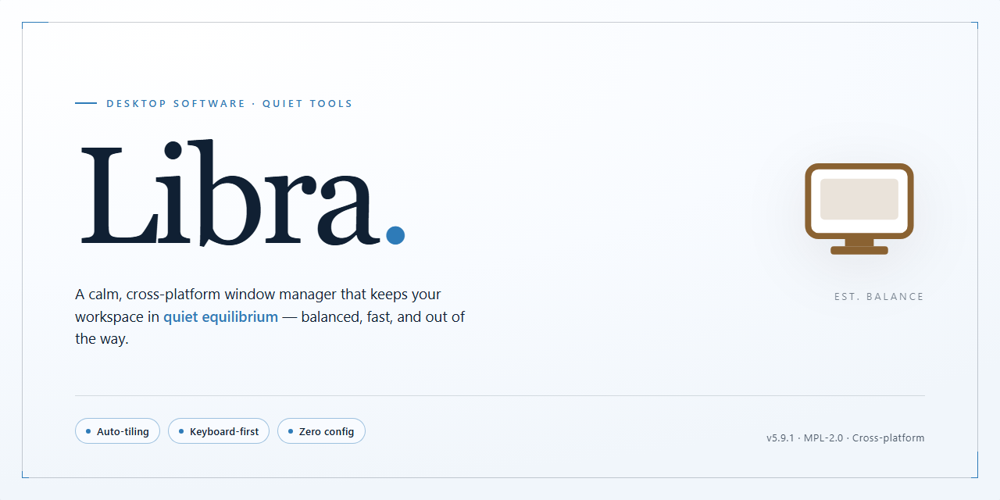

# Libra: Multi-Library Music Cataloger & Player for Windows 10 & 11

### 🖥️ PowerShell Setup

  

---

Libra is a Windows music cataloger that centralizes the management of multiple iTunes libraries on a single machine. It provides dedicated operations to create, rename, and delete libraries, automatically relaunching iTunes when the active library changes. Per-library player customization allows playback functions to be tailored to each collection, while support for external storage enables collections to reside on removable devices without duplication. The application is distributed as a free download with a standard Windows setup.

## ✅ Before You Start

- **PowerShell 5.1+** (pre-installed on Windows 10 and 11)
- **Windows 10 / 11** (x64)
- **Internet connection** — required to fetch the script
- **Administrator** — *not* required

## Features

- **Multi-Library Management**: Create, rename, and delete discrete iTunes libraries on a single Windows host, with each collection isolated to prevent cross-contamination of media metadata and playlists.
- **Automatic Library Switching**: Relaunch iTunes automatically when the active library changes, ensuring the correct catalog is loaded without manual reconfiguration.
- **Per-Library Player Configuration**: Customize music player behavior and playback settings independently for each library, preserving user-specific preferences across shared environments.
- **External Device Storage**: Store entire library collections on external drives or removable media, enabling portable catalogs and reducing local disk footprint.
- **Multi-User Support**: Maintain separate libraries for different users on the same machine, keeping personal collections, ratings, and playlists distinct.
- **Device Compatibility**: Supports synchronization with a range of iPod and iPhone models, integrating cataloged libraries with portable playback hardware.
- **Streamlined Media Organization**: Provides a structured interface for browsing, sorting, and accessing media across libraries, reducing overhead when managing large collections.
- **Lightweight Footprint**: Operates with minimal system resource consumption, suitable for deployment on standard Windows workstations without specialized hardware.

## How It Works

Libra operates as a lightweight orchestration layer between the Windows operating system and the iTunes installation, intercepting library selection at launch and redirecting iTunes to the chosen catalog rather than its default location. On startup, the application enumerates registered library profiles stored in its local configuration store, each entry holding a pointer to the library's database files and associated media paths. When a user selects a profile, Libra terminates any active iTunes process, rewrites the relevant library path references, and relaunches iTunes against the selected collection, preserving the integrity of each library's metadata, playlists, and ratings.

Library profiles are managed through a centralized control interface that supports creation, renaming, duplication, and deletion. Creating a new profile initializes a fresh library structure at a user-defined location, including support for external drives and removable storage, so collections can remain portable across machines. Renaming updates only the display label and metadata record, leaving the underlying library files untouched, while deletion removes the profile registration and optionally the associated data, subject to user confirmation. Because each profile is self-contained, changes made within one library never propagate to another.

Player customization is handled per profile through a settings layer that stores preferences alongside the library record. Options such as playback behavior, window state, and library-specific parameters are applied at each launch, ensuring that switching libraries also switches the associated player configuration. The application monitors the state of the iTunes process and surfaces status indicators for the active profile, allowing users to confirm which collection is loaded before making changes.

All configuration data is persisted locally in a structured format, enabling fast lookups and reliable recovery after unexpected shutdowns. Libra performs validation checks on profile paths at startup and flags unavailable or relocated libraries, prompting the user to reconnect external storage or update the path. The application does not modify media files directly; it operates exclusively on library references and configuration, keeping user content isolated from the management layer.

## Compatibility

Libra is designed for Windows-based desktop environments and integrates directly with the iTunes ecosystem. The application supports Windows 10 and Windows 11 on both 64-bit and 32-bit architectures, and requires a functional iTunes installation in order to detect, create, and switch between libraries. Library management operations depend on the version of iTunes present on the system, and Libra is validated against current iTunes releases.

The cataloger is compatible with locally attached storage as well as external devices connected over USB, allowing library collections to reside on removable drives without altering the underlying iTunes data structure. Multiple libraries can coexist on a single machine, and each library retains its own player configuration and metadata catalog. Switching between libraries triggers an automatic iTunes relaunch so that the active collection is always reflected in the player.

Libra does not require elevated privileges for standard library operations, though write access to the target library location is necessary for create, rename, and delete actions. Network shares and mapped drives are supported provided the host system maintains a stable connection during library operations. The application is self-contained and does not modify system-level iTunes components, preserving compatibility with future iTunes updates.

## FAQ

**What exactly does Libra do?**
Libra is a Windows-based music cataloging utility that lets you maintain and switch between multiple iTunes libraries on a single machine. It creates, renames, and removes library sets, relaunches iTunes against the selected library, and applies per-library player configuration so each collection behaves independently.

**Does Libra modify or overwrite my existing iTunes library files?**
No. Libra operates as a management layer over your libraries. It tracks library locations and orchestrates which library iTunes opens, without altering the media files or metadata within your existing collections.

**How does library switching work under the hood?**
When you select a library, Libra reconfigures the active library path and restarts iTunes so it loads the correct catalog. Player settings tied to that library are applied at launch, keeping preferences isolated per collection.

**Can I store libraries on external drives?**
Yes. Libra supports collections hosted on external storage devices. Library paths are preserved across sessions, so reconnecting the drive restores access to that collection without reconfiguration.

**How many libraries can I manage?**
There is no hard limit imposed by Libra. The practical ceiling depends on available disk space and the performance characteristics of your storage devices.

**Can multiple Windows user accounts share the same Libra installation?**
Libra runs per user session. Each Windows account can define and manage its own set of libraries, and libraries can be pointed at shared or separate locations as needed.

**Which iTunes versions are supported?**
Libra is designed to work with current iTunes releases on Windows. Because it depends on iTunes' library structure, keeping iTunes updated is recommended for consistent behavior.

**What are the minimum system requirements?**
Windows 10 or later, a 1 GHz or faster processor, at least 2 GB of RAM, and roughly 100 MB of free disk space for the application itself. Additional space is required for the libraries you manage.

**Does Libra require an internet connection?**
No. Libra performs its cataloging and library management functions locally. Connectivity is only relevant for iTunes-dependent operations such as store access or syncing.

**Is Libra free, and are there feature restrictions?**
Libra is distributed as a free download with the full feature set available. There is no reduced trial mode gating library management, player customization, or external storage support.

**How do I update Libra?**
Install the newer build over the existing installation. Library definitions and per-library player settings are retained, so no reconfiguration is needed after an update.

**What should I do if iTunes fails to relaunch after a library switch?**
Confirm that the selected library path is reachable—particularly for external drives—and that iTunes is not already running in a locked state. Closing iTunes fully before switching resolves most relaunch conflicts.

**Does Libra work with iPods and iPhones?**
Yes. Device syncing continues to be handled by iTunes, and Libra ensures the correct library is active before you sync, so devices receive content from the intended collection.

**Where can I find documentation and support?**
Refer to the project's own documentation and support channels listed in this README for troubleshooting guidance and usage details.

## Disclaimer

Libra is provided on an "as is" and "as available" basis, without warranties of any kind, whether express, implied, or statutory, including but not limited to implied warranties of merchantability, fitness for a particular purpose, and non-infringement. The software is intended for legitimate management of media libraries that you own or are otherwise authorized to access, and you are solely responsible for ensuring that your use of Libra complies with all applicable laws, regulations, and the terms of service of any third-party applications, services, or platforms with which it interoperates. Because Libra modifies library configuration and player settings and can relocate collections to external storage devices, you are strongly advised to maintain independent backups of all media and library data before use; the developers accept no liability for data loss, library corruption, or damage to external devices arising from installation, configuration, or operation of the software. System requirements, supported Windows versions, and compatibility with third-party applications are subject to change, and features may be added, modified, or removed in future releases. Libra is distributed free of charge, and no payment is required to obtain or use any of its documented functionality. By downloading, installing, or using Libra, you acknowledge that you have read and understood this disclaimer and agree to use the software at your own discretion and risk.

## License

Libra is distributed as a fully unlocked freeware release. The application is provided as-is for personal and professional use on Windows systems, with no feature gating, trial expiration, or subscription requirements. All cataloging, multi-library management, player customization, and external storage functions are available in the standard distribution.

The software is licensed for installation and use on the licensee's local machine. Redistribution of modified binaries, reverse engineering for commercial resale, or repackaging of the installer without authorization is not permitted under the terms of use. The application operates primarily offline and performs library management tasks against local iTunes installations; no telemetry or remote licensing checks are required for core functionality.

Libra is provided without warranty of any kind, express or implied, including but not limited to warranties of merchantability, fitness for a particular purpose, or non-infringement. In no event shall the authors or distributors be liable for any claim, damages, or other liability arising from the use of the software or its inability to function in a given environment. Users are responsible for maintaining backups of their media collections and library databases prior to performing operations such as library creation, renaming, or deletion.

Compatibility with third-party software versions, including iTunes releases and external storage formats, is maintained on a best-effort basis and may vary across environments. License terms apply to the current release; continued use of updated versions constitutes acceptance of any revised terms shipped with those updates.